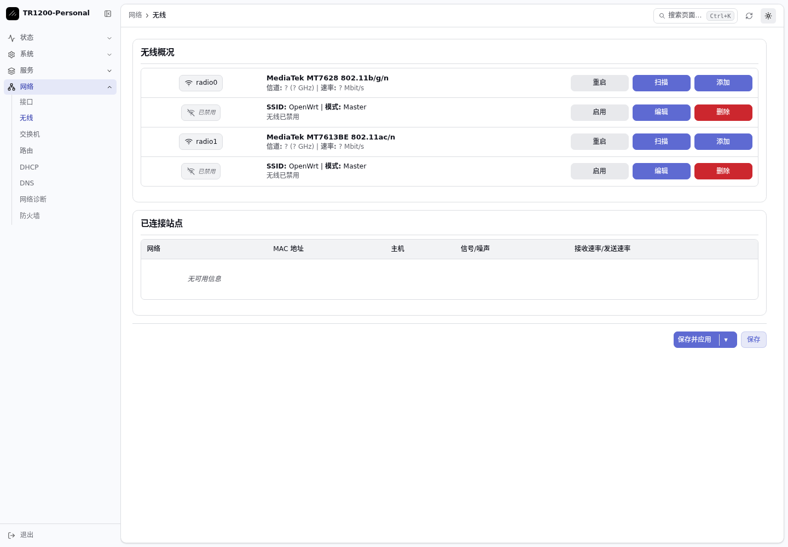

<p align="center">
  
</p>

<p align="center">
  专用于 <strong>Cudy TR1200 v1 / AC1200</strong> 旅行路由器。<br>
  固定软件版本，源码与定制配方留档，按设备所有者的需求维护。
</p>

<p align="center">
  <a href="https://downloads.openwrt.org/releases/25.12.5/"></a>
  <a href="devices/tr1200/README.md"></a>
  <a href="devices/tr1200/fixed-release/README.md"></a>
</p>

<p align="center">
  <a href="#当前系统">当前系统</a> ·
  <a href="devices/tr1200/fixed-release/README.md">维护规则</a> ·
  <a href="reference/README.md">源码备份</a> ·
  <a href="devices/tr1200/RUNBOOK.md">迁移与恢复</a>
</p>

> [!IMPORTANT]
> 本仓库只维护 **Cudy TR1200 v1**。AC1200 是无线速率等级，刷写前仍需核对完整型号和硬件版本。
> 已发布的基础候选镜像与当前实机的个性化系统有所不同，请先阅读[设备说明](devices/tr1200/README.md)及[实机记录](devices/tr1200/FIELD-TEST.md)。

## 当前系统

| 项目 | 已归档的实机状态 |
| :--- | :--- |
| **硬件** | MediaTek MT7628AN · 128 MiB RAM · 16 MiB NOR · 百兆 WAN / LAN |
| **基础系统** | OpenWrt 25.12.5 · Linux 6.12.94 · `ramips/mt76x8` |
| **管理界面** | 中文 LuCI，shadcn 主题适配；保留 Argon 和 Bootstrap 回退 |
| **PassWall** | 26.10.29-r1，搭配 sing-box 1.13.21 精简核心；实机已导入私有节点并启用代理 |
| **指示灯** | 正常时白灯常亮，连续检测异常时红灯常亮，恢复后自动转白 |
| **软件维护** | 关闭在线软件源，保留固定版本；升级或个性化由设备所有者发起 |

当前 194 个已安装包的精确版本见[现场软件清单](devices/tr1200/fixed-release/installed-packages.json)。
现场管理地址为 `192.168.20.1`；历史基础候选镜像的默认地址为 `10.0.0.1`。
密码、私钥、节点订阅及设备备份均不进入仓库。

### 现代管理界面

<p align="center">
  
</p>

基于 shadcn 主题进行轻量适配，提供页面搜索、紧凑侧栏、浅深色模式和手机布局。
[界面源码与构建](devices/tr1200/ui/modern/README.md) · [Argon 回退方案](devices/tr1200/ui/argon/README.md)

### 小闪存定制

[PassWall 精简方案](devices/tr1200/passwall/README.md)将代理核心和 DNS 组件重新压缩进只读镜像，
不依赖外置存储。VLESS、VMess、Trojan、Hysteria2 已通过本地加密传输测试；
之后已完成真实 VLESS Reality、TUIC 节点和自动测速组合的公网传输测试；订阅服务未测试。
当前使用 2.4G 接收上游，同时提供 2.4G、5G 下游 Wi-Fi 和有线 LAN。
两路无线已用闲置客户端接口、独立路由表完成测试，主用网络保持原样；
验证范围和资源适配见 [实际节点运行说明](devices/tr1200/passwall/runtime/README.md)。

[系统状态灯](devices/tr1200/leds/README.md)使用现有红白 LED 和一个轻量观察服务，
检查上游、DNS、管理服务、启用中的代理与 HTTPS 访问；有启动宽限和连续失败判断。
网络、Wi-Fi、节点和灯语等日常设置仍可按需调整。

## 源码与维护

| 内容 | 入口 |
| :--- | :--- |
| **维护策略与精确版本** | [固定版本规则](devices/tr1200/fixed-release/README.md) |
| **系统源码与厂商资料** | [上游源码、feeds、设备树与补丁](reference/README.md) |
| **代理核心与 DNS** | [固定源码及裁剪配方](devices/tr1200/passwall/README.md) |
| **界面与灯语** | [现代界面](devices/tr1200/ui/modern/README.md) · [灯语配置](devices/tr1200/leds/README.md) |
| **设备操作与验证** | [到货及恢复操作单](devices/tr1200/RUNBOOK.md) · [实机记录](devices/tr1200/FIELD-TEST.md) |

后续维护按选定版本修改源码、检查依赖与闪存余量、构建并验证，再应用本地包或镜像。
基础 OpenWrt 和 feeds 保留完整上游快照；备份范围与构建依赖边界见[源码说明](reference/README.md)。

## 基础候选与复现

历史基础候选 [tr1200-v0.1.1-candidate](https://github.com/Renwang-Huang/cudy-personal-openwrt/releases/tag/tr1200-v0.1.1-candidate)
用于记录最小系统的迁移与复现结果，**不包含当前实机的全部个性化改动**。
该版本已完成[云端独立重建](https://github.com/Renwang-Huang/cudy-personal-openwrt/actions/runs/41443725093)，
并通过单台设备的迁移、启动、有线管理和软件重启验证。

在 Linux x86_64 主机准备[构建依赖](devices/tr1200/README.md#构建与复现)，从仓库根目录运行：

```sh
git clone https://github.com/Renwang-Huang/cudy-personal-openwrt.git
cd cudy-personal-openwrt
python3 devices/tr1200/scripts/reproduce-release.py
```

此命令使用归档 ImageBuilder 与软件包缓存复现历史基础镜像。
当前 PassWall 和主题的独立构建脚本保存在各自目录，整套个性化镜像尚未完成从全新主机开始的独立重建验证。
后续镜像应应用[关闭运行时软件源的叠加配置](devices/tr1200/fixed-release/README.md)。

无线收发、WAN 吞吐、USB 负载、长时间稳定性及完整原厂恢复仍有未覆盖项，详见实机记录。

<details>
<summary>项目目录</summary>

```text
devices/tr1200/
├── scripts/        基础镜像构建、复现与检查
├── fixed-release/  固定版本策略、现场包清单与关闭源配置
├── passwall/       精简代理核心与 DNS 配方
├── ui/             现代界面和 Argon 回退方案
└── leds/           白色正常、红色异常的状态灯
reference/
├── sources/        OpenWrt 与官方 feeds 源码快照
├── tr1200/         厂商资料、设备树与上游补丁
├── passwall/       代理与 DNS 源码归档
└── ui/             主题上游源码
scripts/            共用源码归档工具
```

临时构建目录、下载缓存和私人设备备份不进入 Git。
设备配置与历史复现输入保持独立，修改当前系统时应同步更新相应的配方和现场版本记录。

</details>

## 上游与许可

本项目基于 [OpenWrt](https://github.com/openwrt/openwrt)，结合 [Cudy 官方资料](https://www.cudy.com/en-us/products/tr1200-1-0)
与设备社区的适配工作。具体来源和固定提交记录在设备锁文件与参考目录中。

原创脚本和文档遵循 [MIT License](LICENSE)；固件组件、上游源码与厂商资料遵循各自许可证。
