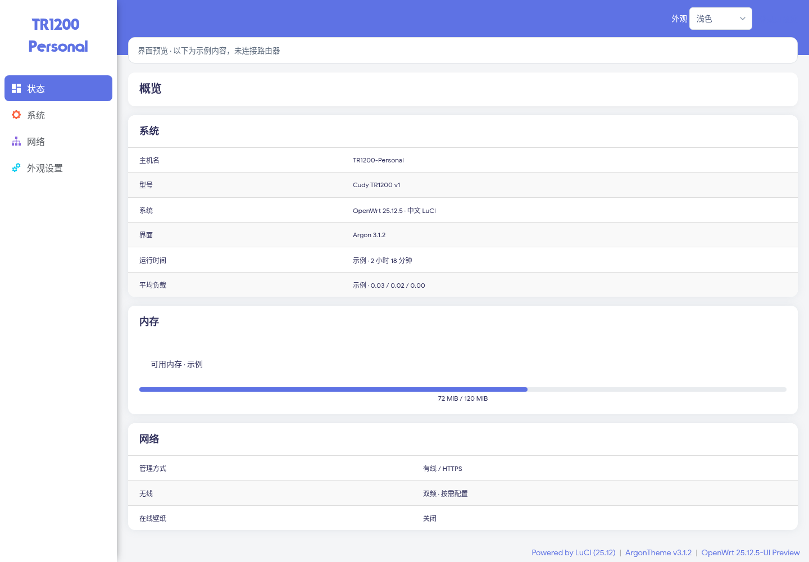
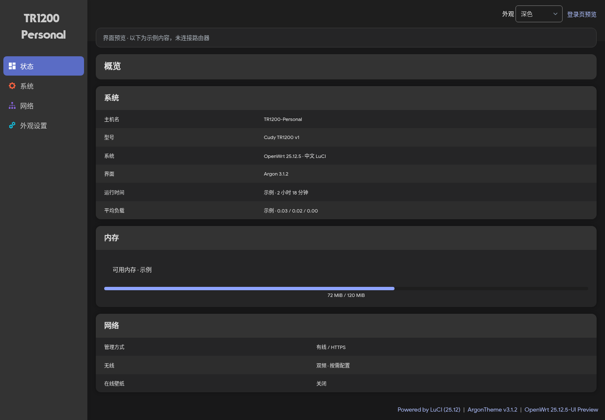
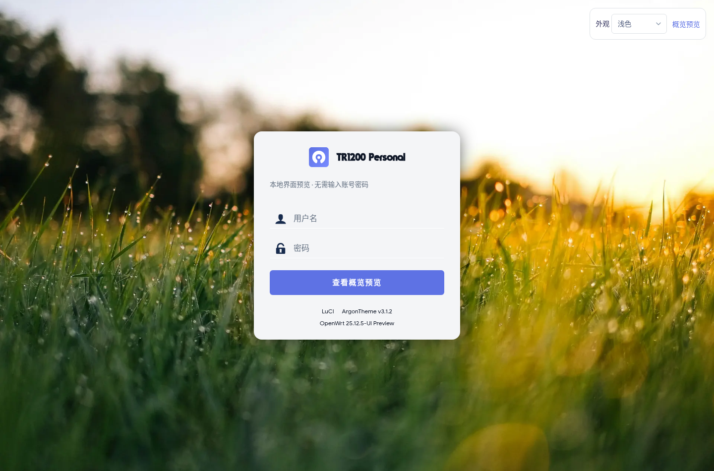
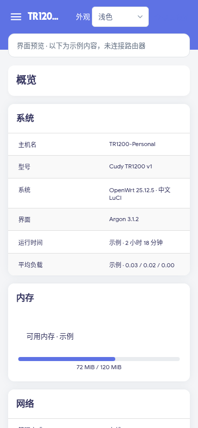

# TR1200 · Argon 界面

基于 [Argon v3.1.2](https://github.com/jerrykuku/luci-theme-argon/releases/tag/v3.1.2)，
为 **Cudy TR1200 v1 / OpenWrt 25.12.5** 准备的可选界面方案。
它更换 LuCI 的登录页、导航、表单和状态页外观，继续使用 OpenWrt 的管理功能。

**当前状态：一台 TR1200 v1 已完成实际安装和浏览器验证，见 [实机记录](FIELD-TEST.md)。**
已发布的 v0.1.1 固件及各设备构建配方保持原样；此目录不是新的固件发布。

## 界面预览

以下图片由当前系统的 MIPS 运行时渲染 Argon 原版模板，再在浏览器中截图。
概览内容、导航交互使用本地示例，无路由器会话或私人配置。安装后具体页面以 LuCI 为准。

| 桌面浅色 | 桌面深色 |
| --- | --- |
|  |  |

| 登录页 | 手机概览 |
| --- | --- |
|  |  |

实机使用中文、跟随系统切换浅深色、居中登录页；关闭在线壁纸和背景模糊，不使用视频背景。
保留主题自带静态图片。前端样式由管理电脑或手机渲染，实际运行开销仍需安装后观察。
新版已集成外观配置，不安装旧的独立 `luci-app-argon-config`。
主题提供手动检查更新；这份方案固定版本，后续升级应重新检查来源和兼容性。

## 空间与依赖

| 新增包 | 固定版本 | 安装内容 |
| --- | --- | ---: |
| luci-theme-argon | 3.1.2-r1 | 662,518 字节 |
| luci-i18n-argon-config-zh-cn | 3.1.2-r1 | 6,187 字节 |
| coreutils-timeout | 9.9-r2 | 29,372 字节 |
| flock | 2.41.5-r1 | 20,919 字节 |
| coreutils、librt、libpthread | 9.9-r2 / 1.2.5-r5 | 元包，合计 3 字节 |

合计 **718,999 字节，约 702 KiB**，安装包下载合计约 324 KiB。
这些是包元数据中的文件体积；实际闪存占用还包括包管理记录、目录及文件系统开销。
这台实机安装前约 8.8 MiB、安装后约 8.3 MiB 可用 overlay；安装脚本要求至少 4 MiB 可用空间。

现有系统已提供 `luci-base`、`jsonfilter`、`ucode-mod-math`，
`uclient-fetch` 提供 `wget-any`。以当前实机软件包数据库进行隔离模拟，
只新增上述 7 个包，未要求升级或删除现有包。不可将这个结果直接套用于其他版本或设备。

## 在电脑准备离线材料

从仓库根目录运行，普通用户即可。此命令只访问软件源和本地文件，不连接路由器：

```sh
python3 devices/tr1200/ui/argon/prepare.py
```

源码快照及软件包输入固定在 `artifacts.lock.json`，下载后自动核对大小与完整性。
主题使用上游发布附件，基础依赖从 OpenWrt 对应版本官方源获取。
程序在 `work/tr1200-ui-argon-3.1.2/` 生成离线包、安装目录和本地预览；不会改写旧发布产物。
如果本地没有 APK v3 主机工具，离线包仍可生成；通过 `--apk /path/to/apk` 可补充预览资源。

查看交互预览：

```sh
python3 -m http.server 8765 --bind 127.0.0.1 \
  --directory work/tr1200-ui-argon-3.1.2/preview
```

浏览器打开 `http://127.0.0.1:8765/overview.html`，可以切换外观、查看登录页和手机导航。
预览不接受密码，也不发出路由器管理请求。

## 安装与回退

**下述命令会操作路由器，已在一台实机执行。** 安装前先下载保存现有配置，确保 SSH 可用。
脚本面向首次安装；如果已安装 Argon 或已有同名备份，会拒绝重复执行，保留已有备份。
将电脑生成的离线包传到路由器 `/tmp/` 并解压，进入解压目录后先运行：

```sh
sh apply.sh --check
```

脚本核对型号、系统版本、保留的 Bootstrap、可用空间及软件包文件，并模拟离线依赖事务。
检查通过后，实际安装的独立命令是：

```sh
sh apply.sh --apply
```

安装前将 LuCI 和已有 Argon 配置备份到 `/root/ui-backups/argon-v3.1.2/`。
安装使用本地包，不联网更新全系统；完成后仅重启 `rpcd`，无需刷写或重启设备。
重新打开浏览器页面并登录，检查概览、网络接口、无线设置、中文、深浅色与手机布局。

如果新界面打不开，通过 SSH 运行：

```sh
sh /root/ui-backups/argon-v3.1.2/rollback.sh
```

回退恢复原 LuCI 配置，保留 Argon 和依赖包，避免影响以后共享这些依赖的插件。
如回退脚本不可用，可通过 SSH 将 `luci.main.mediaurlbase` 设置回 `/luci-static/bootstrap`
并提交 LuCI 配置。切换主题不能代替设备无法启动时的固件恢复流程。
这次变更不需要写入启动程序、分区表或无线校准分区。

## 验证边界与来源

准备阶段完成软件包结构检查、隔离依赖求解、电脑副本中的安装、11 个模板编译、
2 个 ucode 模块导入，以及桌面和手机预览检查。详见 [本地验证记录](VALIDATION.md)。
随后在一台实机完成安装、实际登录、主题 RPC 权限与保存后刷新验证，见 [实机记录](FIELD-TEST.md)。
这不代表其他硬件批次、新增插件或长期运行均已验证。

Argon 源码完整快照保存在 `reference/ui/argon-v3.1.2.tar.gz`，保留上游许可证，未修改主题代码。
基础依赖的来源沿用官方包配方与原始源码地址，未在本目录重新编译。
预览辅助代码和安装脚本使用本仓库的 MIT 许可；Argon 及其他组件遵循各自许可。

- [Argon 项目](https://github.com/jerrykuku/luci-theme-argon)
- [固定版本发布](https://github.com/jerrykuku/luci-theme-argon/releases/tag/v3.1.2)
- [OpenWrt 软件包管理说明](https://openwrt.org/docs/guide-user/additional-software/apk)
