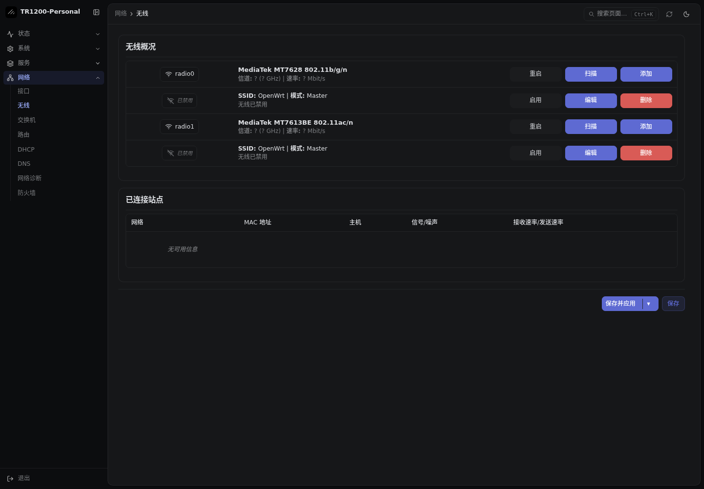
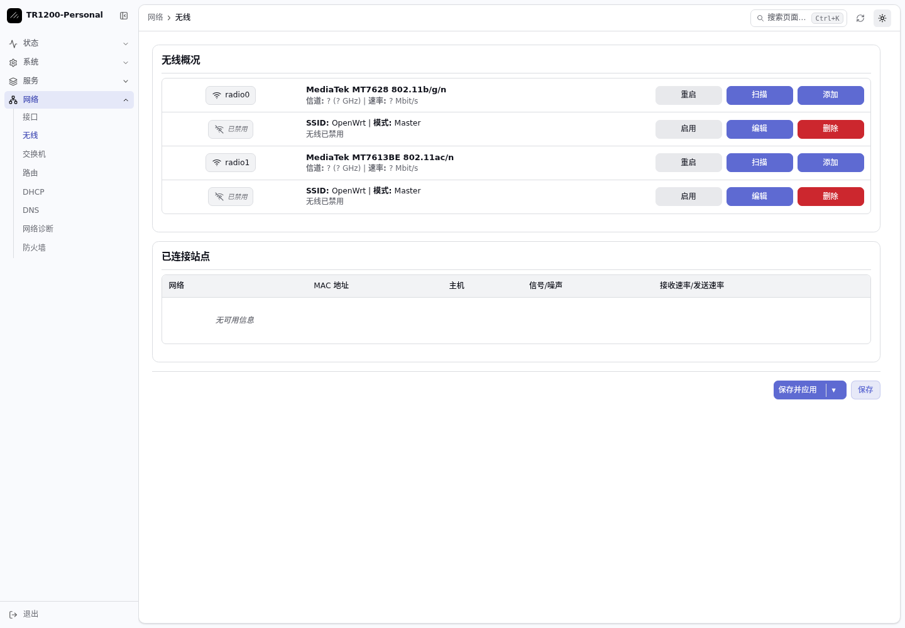

# Cudy · 现代管理界面

基于 [luci-theme-shadcn](https://github.com/eamonxg/luci-theme-shadcn) 固定源码，
为 TR1200 小闪存环境进行轻量适配。已在一台 OpenWrt 25.12.5 / TR1200 v1 上实际安装。

| 深色 | 浅色 |
| --- | --- |
|  |  |

新界面使用紧凑侧栏、面包屑、可搜索的页面导航、细边框表格和现代控件，支持侧栏折叠、
手机抽屉和深浅色选择。无线页保留 LuCI 的原有操作，PassWall 状态卡片的边框和图标与主题统一。

上图为这台路由器无私人节点、无已连接无线客户端时的页面截图；无线处于禁用状态，
不表示界面升级会自动开启无线。

## 适配内容

- 依赖仅为系统已有的 `luci-base`，未增加后台服务，无需重新刷机。
- 去除额外字体文件，使用系统字体；登录位图背景改为约 1 KiB 的本地 SVG。
- 运行资源约 312 KiB，APK 约 124 KiB；现场安装后仍有约 1.7 MiB 可写空间。
- 修正匿名登录页加载认证 RPC 的兼容问题；保留浏览器缩放，增加中文搜索提示。
- 无线旧图标换为线条图标，统一信息对齐；PassWall 状态卡片保持原有状态与操作逻辑。
- 原 Argon、Bootstrap 和回退配置保留。主题切换不修改网络、无线、DNS、防火墙或节点设置。

## 构建与安装

从仓库根目录，以普通用户执行：

```sh
python3 devices/tr1200/ui/modern/prepare.py
```

脚本验证 `reference/ui/` 中的完整上游源码快照，应用本目录的轻量改动并生成 APK。
需要 APK v3 主机工具和 `fakeroot`；默认使用现有 TR1200 ImageBuilder 的主机工具。
可通过 `--apk /path/to/apk` 指定其他兼容版本。
生成文件在 `work/tr1200-modern-theme-build/`，不会连接路由器。

在其他设备实际安装前，需要单独核对空间和 LuCI 版本。保存 `/etc/config/luci`、
已有主题与完整配置备份后，上传 APK，先用 `apk add --simulate` 检查依赖事务；
此 APK 的安装脚本只注册主题入口，不自动切换当前界面。

```sh
apk --no-network --repositories-file /dev/null add --allow-untrusted /tmp/luci-theme-shadcn-cudy-0.6.1-r3.apk
uci set luci.main.mediaurlbase='/luci-static/shadcn'
uci commit luci
/etc/init.d/rpcd restart
```

上述安装命令已在这台设备执行；勿在不匹配的型号上直接套用现场备份路径。
新主题的外观选择保存在浏览器，手机、电脑可各自选择；原 Argon 的外观配置不会同步到新主题。

## 回退

这台设备的安装前 LuCI 配置和回退脚本位于 `/root/ui-backups/shadcn-cudy-v1/`。
通过 SSH 执行：

```sh
sh /root/ui-backups/shadcn-cudy-v1/rollback.sh
```

脚本恢复原 LuCI 配置并重启 `rpcd`，浏览器刷新后回到 Argon。
此备份目录已加入该设备的升级备份列表；电脑也另存完整配置。
部署时核对了备份和回退脚本，未在最终正常界面上执行回退。

## 验证与来源

实测包括登录、概览、无线、接口、防火墙、系统、PassWall 基本设置和订阅页，
以及无线编辑弹窗打开/关闭、深浅色保存、侧栏折叠、页面搜索和手机抽屉。
手机无线、系统、PassWall 页面无横向溢出；认证后的页面无脚本错误或缺失资源。
结构化范围见 [validation.json](validation.json)。这不代替未安装插件和所有页面的组合验证。

上游源码和许可证完整归档在 `reference/ui/shadcn-9e6dd4439064.tar.gz`，固定输入见
[source.lock.json](source.lock.json)。未手工改写上游生成的主样式或脚本，
局部样式、轻量资源和模板修正由本目录构建脚本应用。

上游主题遵循 Apache-2.0，本目录新增适配脚本与样式遵循本仓库 MIT 许可。
私人配置、凭据和包含私人设备信息的采集文件仅保存在本地 `work/`。
